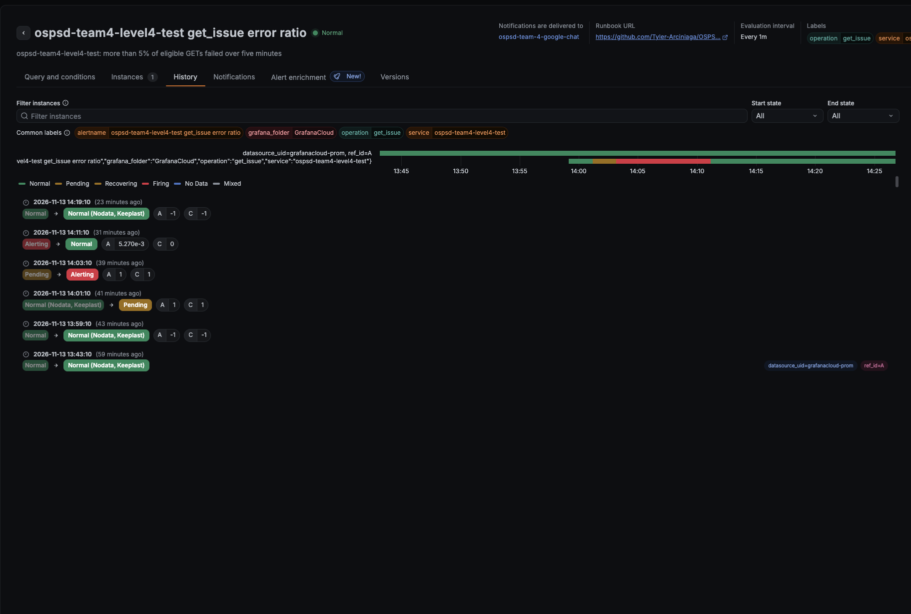
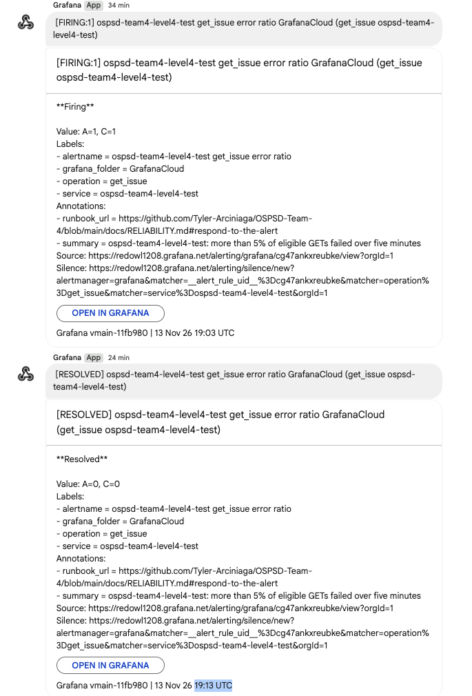
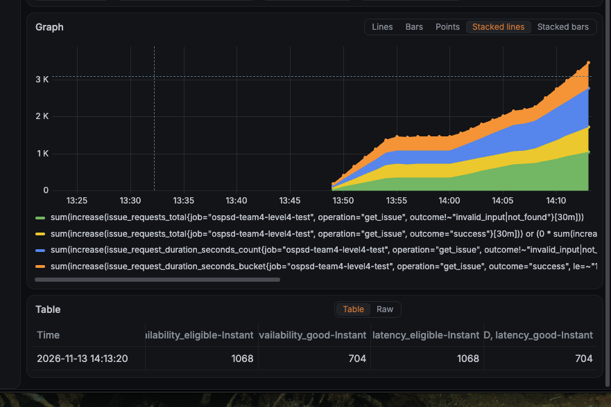
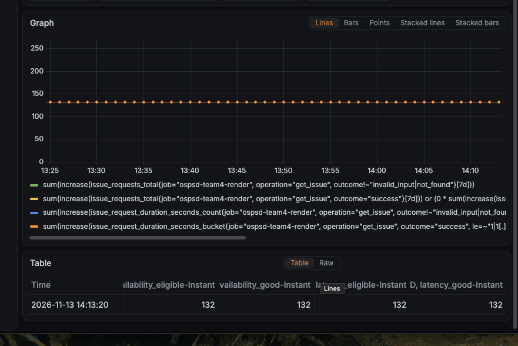

# Level 4 alert and SLI exercise (November 13, 2026)

Disposable verification from [Reliability](../RELIABILITY.md#disposable-verification).
Performed by Tyler. All times are UTC. Grafana shows local time (EST, UTC−5);
those values are converted here.

## Setup

| Item | Value |
| --- | --- |
| Release | `ad0358a955930c4783228ec47273ae47efa0427c` (merge of #59), passed as `GIT_SHA` on every server run |
| Service | Local controlled server (`tests.controlled.server`) on `127.0.0.1:8001`, in-memory provider |
| Telemetry job | `OTEL_SERVICE_NAME=ospsd-team4-level4-test`, exported to the team Grafana stack over OTLP |
| Alert rule | Duplicate of the production rule with the job and `service` label replaced by `ospsd-team4-level4-test`; same > 0.05 threshold, 1m evaluation, 2m pending period, Keep Last State |
| Destination | Team Google Chat space (Grafana Google Chat contact point); members told before starting |
| Generator | The bounded generator in the Reliability guide: one temporary issue, 360 GETs one second apart, deleted afterwards |

## Timeline

| Phase | Event | Time (UTC) or counts |
| --- | --- | --- |
| Healthy | Generator start / end | 18:48:14 / 18:54:18, `{200: 360}` |
| Healthy | Rule state checked: Normal | 18:59 |
| Fault | Server restarted with `CONTROLLED_FAULT=get_fails` | 18:59:46 |
| Fault | Generator run | `{502: 360}` |
| Fault | Rule evaluation: Normal → **Pending** (error ratio 1) | 19:01:10 |
| Fault | Rule evaluation: Pending → **Alerting** (error ratio 1) | 19:03:10 |
| Fault | Firing message received in Google Chat | 19:03 |
| Recovery | Server restarted healthy (fault unset) | 19:07:20 |
| Recovery | Generator start | 19:07:36, `{200: 360}` |
| Recovery | Rule evaluation: Alerting → **Normal** (error ratio 0.00527) | 19:11:10 |
| Recovery | Resolved message received in Google Chat | 19:13:10 |
| — | Measurement end time | 19:13:20 |
| — | Rule evaluation: Normal → Normal (nodata, keeplast) after traffic stopped | 19:19:10 |

## SLI and error budget results

Instant queries A–D from the Reliability guide, evaluated at 19:13:20 UTC.

**Test job** (`ospsd-team4-level4-test`, `[30m]` window 18:43:20–19:13:20,
covering all three phases):

| SLI | Eligible | Good | Ratio | Target | Remaining budget (events) |
| --- | --- | --- | --- | --- | --- |
| Availability | 1068 (A) | 704 (B) | 65.92% | 99% | 704 − 0.99 × 1068 = −353.32 |
| Latency | 1068 (C) | 704 (D) | 65.92% | 95% | 704 − 0.95 × 1068 = −310.60 |

The generator sent 1,080 reads. The 12 missing are reads from before each new
server process's first exported sample, which `increase` cannot count. Every
successful read finished within one second, so the latency SLI equals
availability. Both budgets are negative, as expected for a six-minute outage
of every read.

**Production** (`ospsd-team4-render`, `[7d]` window ending 19:13:20):

| SLI | Eligible | Good | Ratio | Target | Remaining budget (events) |
| --- | --- | --- | --- | --- | --- |
| Availability | 132 | 132 | 100% | 99% | 1.32 |
| Latency | 132 | 132 | 100% | 95% | 6.60 |

Both production budgets are positive, so the release policy does not pause
releases. Production was not affected by the exercise.

## Evidence

Grafana displays local time (EST); add five hours for the UTC times above.

**Test rule state history** (Normal → Pending → Alerting → Normal), with the
rule's contact point, labels and evaluation interval:

**Firing and resolved messages** received in the team Google Chat space:

**Explore, queries A–D for the test job** (`[30m]`, instant at 19:13:20 UTC):

**Explore, queries A–D for production** (`[7d]`, instant at 19:13:20 UTC):

