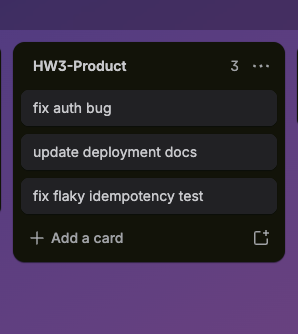
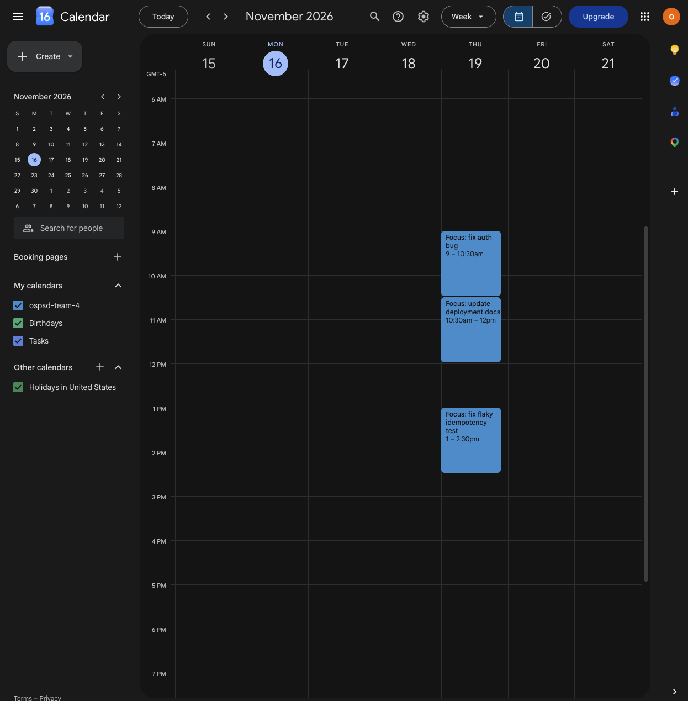
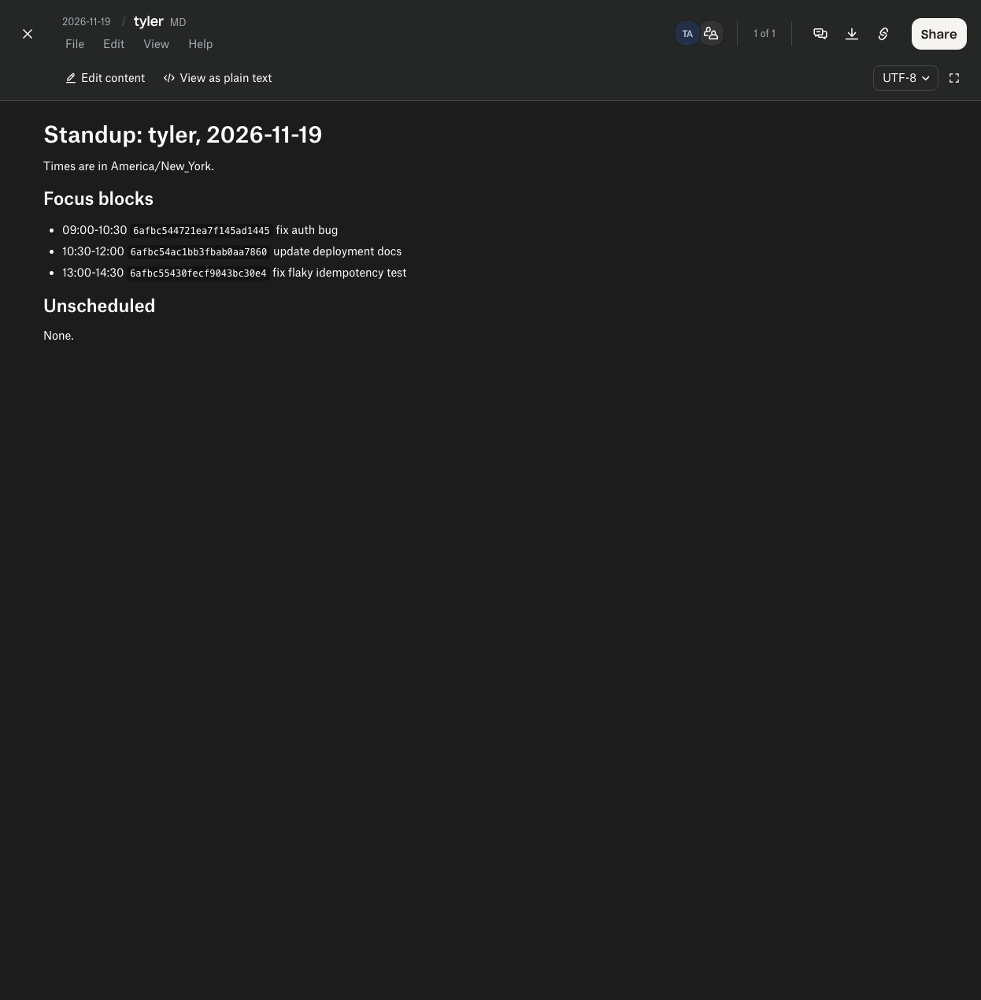

# Live focus-day run (real providers, local)

Status: PASSED on 2026-11-16 (run by Tyler on his laptop).
`POST /v1/focus-day` ran end to end against the real providers: a first
run, a replay that changed nothing, and a replay after one calendar event was
deleted by hand, which recreated only that event.

This run was local, not on Render. It shows the operation works with the
three real implementations; the deployed service is checked separately by
the release smoke check (`product/scripts/smoke_check.py`) after bootstrap.

## Setup

| | |
| --- | --- |
| Product commit | `ae94c6af4abfe3eb1e7a3ba7153d2fb2852b1cc2` (branch `feat/ospsd-team4-product-deployment`), as reported by `/readyz` |
| Tracker | `team_4_issue_tracker_trello:TrelloIssueProvider` (tag `team-4-issue-tracker-trello-v1.0.0`), the product's own Trello test list with three cards |
| Calendar | `team5_calendar:create_calendar_service` (tag `team5-calendar-v0.1.0`), the primary calendar of a dedicated Google test account, OAuth app in Testing mode |
| Storage | `dropbox_client_impl:DropboxDocumentStorage` (tag `v0.3.0`), the Dropbox test app |
| How it ran | `uv run uvicorn ospsd_team4_product.main:app --port 8000` from `product/`, credentials exported in the shell (never written to a file in the repository), the Google token in `~/.config/ospsd-team4/` |

## Request

```json
{"assignee": "tyler", "day": "2026-11-19", "timezone": "America/New_York",
 "working_window": {"start": "09:00", "end": "17:00"},
 "busy": [{"start": "2026-11-19T12:00:00-05:00", "end": "2026-11-19T13:00:00-05:00"}]}
```

No `default_minutes`, so each issue gets the default 90 minutes.

The tracker input: the product's Trello list `HW3-Product` with the three
cards the service read.



## 1. First run

Every step `ok`. Output filtered with
`jq '{status, steps, blocks: .plan.blocks, unscheduled: .plan.unscheduled, created, doc}'`:

```json
{
  "status": "ok",
  "steps": [
    {"name": "list_issues", "status": "ok", "error": null},
    {"name": "plan", "status": "ok", "error": null},
    {"name": "create_events", "status": "ok", "error": null},
    {"name": "write_standup_doc", "status": "ok", "error": null}
  ],
  "blocks": [
    {"issue_id": "6afbc544721ea7f145ad1445", "title": "fix auth bug",
     "start": "2026-11-19T09:00:00-05:00", "end": "2026-11-19T10:30:00-05:00"},
    {"issue_id": "6afbc54ac1bb3fbab0aa7860", "title": "update deployment docs",
     "start": "2026-11-19T10:30:00-05:00", "end": "2026-11-19T12:00:00-05:00"},
    {"issue_id": "6afbc55430fecf9043bc30e4", "title": "fix flaky idempotency test",
     "start": "2026-11-19T13:00:00-05:00", "end": "2026-11-19T14:30:00-05:00"}
  ],
  "unscheduled": [],
  "created": {
    "6afbc544721ea7f145ad1445": "cnrnufjai4cf8av9rip72uk3sk",
    "6afbc54ac1bb3fbab0aa7860": "5b5a1mlvvijdrbu3652cv707q4",
    "6afbc55430fecf9043bc30e4": "jrvuc224n5m4hcejog2uva9egg"
  },
  "doc": {"path": "/standups/2026-11-19/tyler.md", "id": "id:oinkehfsr60AAAAAAAAADA"}
}
```

- The planner placed the three 90-minute blocks back to back from 09:00,
  skipped the 12:00-13:00 busy interval, and scheduled every issue.
- Three `Focus: <title>` events appeared on the test account's calendar at
  those times, and the doc was written at the nested path.

The test account's calendar for Thursday 2026-11-19 (screenshot taken after
step 3, so the third event is the recreated one; its title and time are
unchanged): the three blocks at 09:00-10:30, 10:30-12:00 and 13:00-14:30,
with 12:00-13:00 left free for the busy interval.



The standup doc, opened in Dropbox at `/standups/2026-11-19/tyler.md`. It
lists the three blocks in the request's time zone with each issue ID and
title, and "None." under Unscheduled, matching the response.



## 2. Replay with every event present

The replay body is the request plus the first response's plan and events:
`jq -s '.[0] + {replay: {plan: .[1].plan, created: .[1].created}}' focus-req.json focus-run1.json`.

```json
{
  "status": "ok",
  "steps": [
    {"name": "list_issues", "status": "skipped", "error": null},
    {"name": "plan", "status": "skipped", "error": null},
    {"name": "create_events", "status": "ok", "error": null},
    {"name": "write_standup_doc", "status": "ok", "error": null}
  ],
  "created": {
    "6afbc544721ea7f145ad1445": "cnrnufjai4cf8av9rip72uk3sk",
    "6afbc54ac1bb3fbab0aa7860": "5b5a1mlvvijdrbu3652cv707q4",
    "6afbc55430fecf9043bc30e4": "jrvuc224n5m4hcejog2uva9egg"
  }
}
```

The tracker was not read and the plan was not recomputed. Every event ID is
unchanged, and no duplicate events appeared on the calendar.

## 3. Replay after deleting one event

Between the two replays, the third event (`jrvuc224n5m4hcejog2uva9egg`,
"fix flaky idempotency test") was deleted by hand in Google Calendar. The
same replay body was sent again:

```json
{
  "status": "ok",
  "steps": [
    {"name": "list_issues", "status": "skipped", "error": null},
    {"name": "plan", "status": "skipped", "error": null},
    {"name": "create_events", "status": "ok", "error": null},
    {"name": "write_standup_doc", "status": "ok", "error": null}
  ],
  "created": {
    "6afbc544721ea7f145ad1445": "cnrnufjai4cf8av9rip72uk3sk",
    "6afbc54ac1bb3fbab0aa7860": "5b5a1mlvvijdrbu3652cv707q4",
    "6afbc55430fecf9043bc30e4": "uk8p59rclgtapkkkq03bf54uuc"
  }
}
```

Only the deleted event was recreated, with a new ID; the other two kept
theirs. The recreated event was seen on the calendar.

This confirms, against the real calendar, an assumption replay depends on:
a deleted event must come back from `get` as NOT_FOUND. Google keeps deleted
events with `status: "cancelled"` rather than returning 404, and Team 5's
`get` maps that status to `EventNotFoundError`
(`team5_calendar/google_events.py`), which the product's calendar adapter
maps to `not_found`.

## Not covered by this run

- Failure paths against the real providers (expired token, Dropbox outage,
  uncertain create). These are covered with the in-memory fakes and failure
  injection in `tests/test_focus_day.py`.
- The deployed service on Render.

## Cleanup

The `Focus:` events on 2026-11-19 are deleted by hand in the test account's
calendar. The doc stays; a later run for the same day and assignee
overwrites it.
