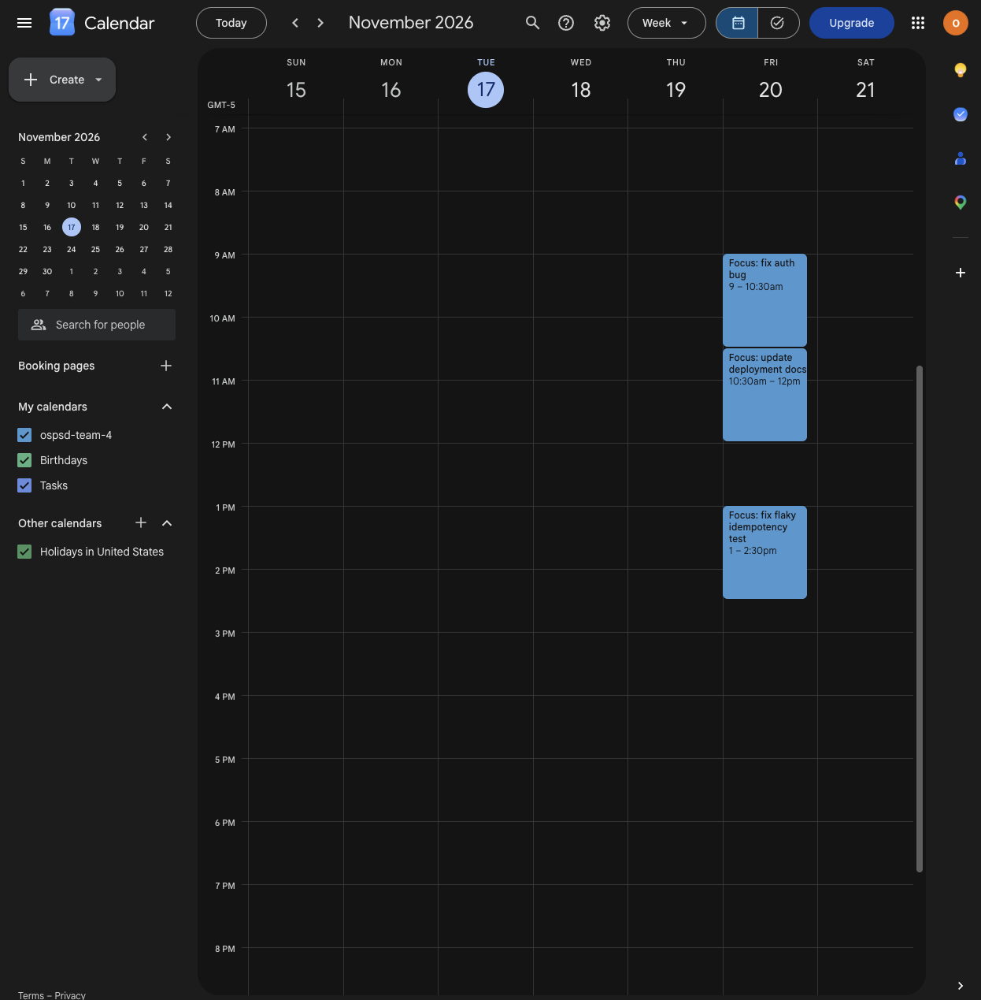
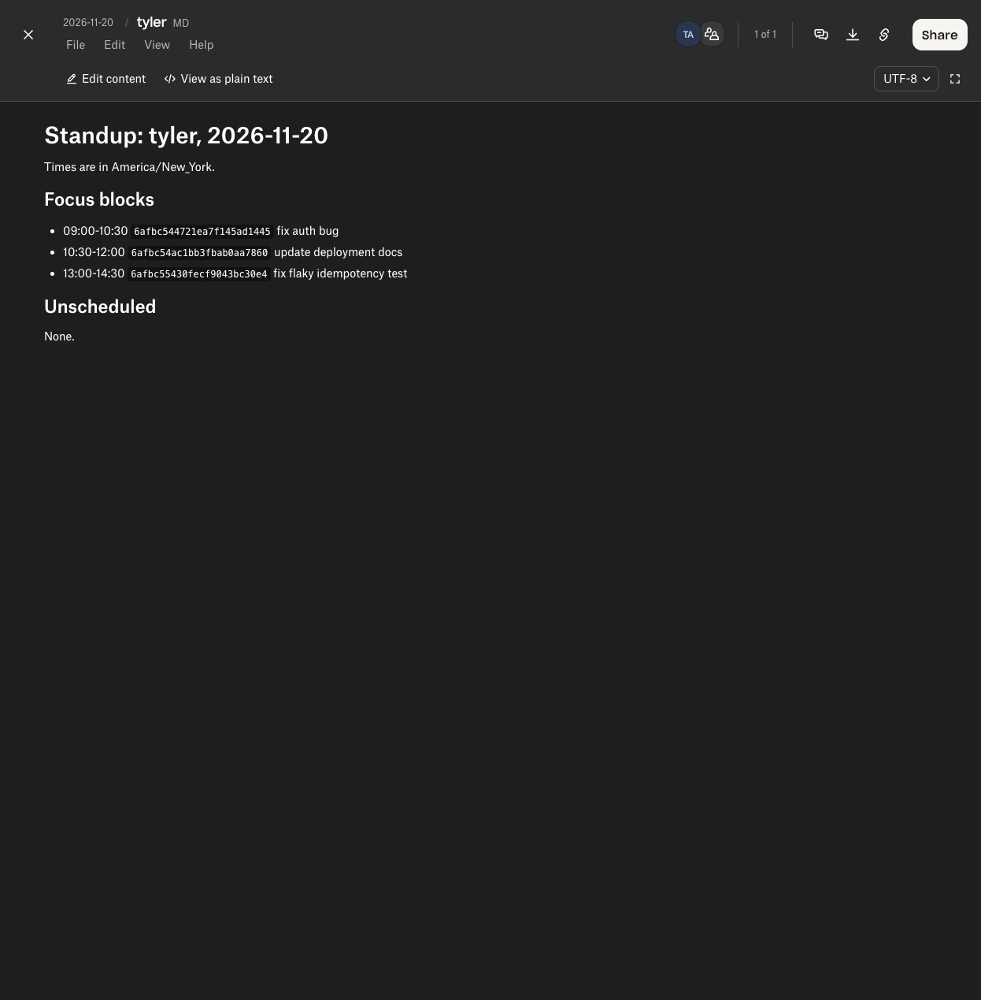

# Storage swap: Team 1's Dropbox implementation (real providers, local)

Status: PASSED on 2026-11-17 (run locally on Tyler's laptop).
The storage vertical was switched from Team 3's Dropbox package to Team 1's
by changing one configuration value, `STORAGE_PROVIDER`. The same
`POST /v1/focus-day` scenario as [focus-day-live.md](focus-day-live.md) then
ran end to end: a first run, then a replay that changed nothing. The results
were checked directly in Dropbox and Google Calendar, outside the service.

No product source changed for the swap. The only code-side change is
installing Team 1's package next to Team 3's (see
[Installing Team 1's package](#installing-team-1s-package)).

## What changed

| | Baseline ([focus-day-live.md](focus-day-live.md)) | This run |
| --- | --- | --- |
| `STORAGE_PROVIDER` | `dropbox_client_impl:DropboxDocumentStorage` | `team1_dropbox:Team1DropboxStorage.from_env` |
| Package | `dropbox-client-impl` 0.1.0, Team 3 (`Shreyas191/OSPSD-Team-3`, tag `v0.3.0`) | `team1-dropbox-storage` 0.1.0, Team 1 (`Dayana20/sandbox`, subdirectory `packages/team1_dropbox`, commit `784be97fc111338c6746b9d7288bf84a333a9b16`) |
| Contract | `cloud-storage-api` tag `0.3.1` (`664afc9`) | same |
| Credentials | `DROPBOX_APP_KEY`, `DROPBOX_APP_SECRET`, `DROPBOX_REFRESH_TOKEN` | same variables, same Dropbox test app |

`TRACKER_PROVIDER`, `CALENDAR_PROVIDER` and every other variable were
unchanged.

The import path names `from_env`, not the class. `Team1DropboxStorage()`
with no arguments raises `InvalidRequestError`, because it expects either a
client or the three credentials as arguments. Our configuration accepts a
dotted attribute after the colon, and the factory is called with no
arguments (`factories.py`), so `Team1DropboxStorage.from_env` is a valid
value as it is.

## Setup

| | |
| --- | --- |
| Product commit | `d18a4150569cfafe7f6d3d78523b607448194d54` (branch `docs/ospsd-team4-product-design`) plus the uncommitted install change below, as reported by `/readyz` |
| Tracker | `team_4_issue_tracker_trello:TrelloIssueProvider`, the `HW3-Product` Trello list (the same three cards as the baseline) |
| Calendar | `team5_calendar:create_calendar_service`, the same Google test account as the baseline |
| Storage | `team1_dropbox:Team1DropboxStorage.from_env`, the same Dropbox test app as the baseline |
| How it ran | `uv run uvicorn ospsd_team4_product.main:app --port 8000` from `product/` (uv 0.12.22, CPython 3.14.8) under `env -i`, so only the variables listed here were set. Credentials were loaded from `~/.config/ospsd-team4/product.env`, outside the repository. |

```sh
env -i PATH="$PATH" HOME="$HOME" GIT_SHA="$(git rev-parse HEAD)" \
  TRELLO_API_KEY=... TRELLO_TOKEN=... TRELLO_LIST_ID=... \
  DROPBOX_APP_KEY=... DROPBOX_APP_SECRET=... DROPBOX_REFRESH_TOKEN=... \
  TRACKER_PROVIDER=team_4_issue_tracker_trello:TrelloIssueProvider \
  CALENDAR_PROVIDER=team5_calendar:create_calendar_service \
  CALENDAR_TOKEN_FILE="$HOME/.config/ospsd-team4/google-calendar-token.json" \
  STORAGE_PROVIDER=team1_dropbox:Team1DropboxStorage.from_env \
  uv run uvicorn ospsd_team4_product.main:app --port 8000
```

```
$ curl -s localhost:8000/readyz
{"status":"ready","checks":{"config":"ok"},"commit":"d18a4150569cfafe7f6d3d78523b607448194d54"}
```

## Request

The baseline request, moved to Friday 2026-11-20 so that it would not touch
the baseline's events and doc for 2026-11-19:

```json
{"assignee": "tyler", "day": "2026-11-20", "timezone": "America/New_York",
 "working_window": {"start": "09:00", "end": "17:00"},
 "busy": [{"start": "2026-11-20T12:00:00-05:00", "end": "2026-11-20T13:00:00-05:00"}]}
```

## 1. First run

HTTP 200, every step `ok`. Output filtered with
`jq '{status, steps, blocks: .plan.blocks, unscheduled: .plan.unscheduled, created, doc}'`:

```json
{
  "status": "ok",
  "steps": [
    {"name": "list_issues", "status": "ok", "error": null},
    {"name": "plan", "status": "ok", "error": null},
    {"name": "create_events", "status": "ok", "error": null},
    {"name": "write_standup_doc", "status": "ok", "error": null}
  ],
  "blocks": [
    {"issue_id": "6afbc544721ea7f145ad1445", "title": "fix auth bug",
     "start": "2026-11-20T09:00:00-05:00", "end": "2026-11-20T10:30:00-05:00"},
    {"issue_id": "6afbc54ac1bb3fbab0aa7860", "title": "update deployment docs",
     "start": "2026-11-20T10:30:00-05:00", "end": "2026-11-20T12:00:00-05:00"},
    {"issue_id": "6afbc55430fecf9043bc30e4", "title": "fix flaky idempotency test",
     "start": "2026-11-20T13:00:00-05:00", "end": "2026-11-20T14:30:00-05:00"}
  ],
  "unscheduled": [],
  "created": {
    "6afbc544721ea7f145ad1445": "tmm5drk24juhr8le1lufvkl4ac",
    "6afbc54ac1bb3fbab0aa7860": "n8lltfvconag1cb7q9emivcnug",
    "6afbc55430fecf9043bc30e4": "40svo5ph3b8n8d3u2vv7h9em60"
  },
  "doc": {"path": "/standups/2026-11-20/tyler.md", "id": "id:oinkehfsr60AAAAAAAAAEQ"}
}
```

The plan is the baseline's, shifted one day: the same three cards, in the
same slots, around the same busy hour. The response has the same shape as the
baseline's. `doc.id` is the Dropbox file ID and has the same account prefix
as the baseline doc (`id:oinkehfsr60...`): the same test app, now written
through a different team's code.

### Checked directly in each provider

A separate script (not the service) read the results back from the provider
APIs. The doc was read with **both** Dropbox packages, to check that what
Team 1's package wrote is a normal Dropbox file that any client can read:

```
Dropbox metadata (Team 1): {'id': 'id:oinkehfsr60AAAAAAAAAEQ', 'path': '/standups/2026-11-20/tyler.md',
  'size': 288, 'modified_at': '2026-11-18T04:20:21Z', 'etag': '016608554487ecb0000000348b0d2e1'}
bytes identical via Team 1 and Team 3: True
```

Doc contents:

```markdown
# Standup: tyler, 2026-11-20

Times are in America/New_York.

## Focus blocks

- 09:00-10:30 `6afbc544721ea7f145ad1445` fix auth bug
- 10:30-12:00 `6afbc54ac1bb3fbab0aa7860` update deployment docs
- 13:00-14:30 `6afbc55430fecf9043bc30e4` fix flaky idempotency test

## Unscheduled

None.
```

Each event fetched from Google with Team 5's `get`:

```
tmm5drk24juhr8le1lufvkl4ac  Focus: fix auth bug                2026-11-20T09:00:00-05:00 to 10:30:00-05:00
n8lltfvconag1cb7q9emivcnug  Focus: update deployment docs      2026-11-20T10:30:00-05:00 to 12:00:00-05:00
40svo5ph3b8n8d3u2vv7h9em60  Focus: fix flaky idempotency test  2026-11-20T13:00:00-05:00 to 14:30:00-05:00
```

The test account's calendar for Friday 2026-11-20: the three blocks at
09:00-10:30, 10:30-12:00 and 13:00-14:30, with 12:00-13:00 left free for
the busy interval.



The doc written by Team 1's package, opened in Dropbox at
`/standups/2026-11-20/tyler.md`. It shows the same bytes as the read-back
above.



## 2. Replay with every event present

Replay body built as in the baseline:
`jq -s '.[0] + {replay: {plan: .[1].plan, created: .[1].created}}' req.json run1.json`.
HTTP 200:

```json
{
  "status": "ok",
  "steps": [
    {"name": "list_issues", "status": "skipped", "error": null},
    {"name": "plan", "status": "skipped", "error": null},
    {"name": "create_events", "status": "ok", "error": null},
    {"name": "write_standup_doc", "status": "ok", "error": null}
  ],
  "created": {
    "6afbc544721ea7f145ad1445": "tmm5drk24juhr8le1lufvkl4ac",
    "6afbc54ac1bb3fbab0aa7860": "n8lltfvconag1cb7q9emivcnug",
    "6afbc55430fecf9043bc30e4": "40svo5ph3b8n8d3u2vv7h9em60"
  },
  "doc": {"path": "/standups/2026-11-20/tyler.md", "id": "id:oinkehfsr60AAAAAAAAAEQ"}
}
```

`created` and `doc` are identical to run 1's. The folder
`/standups/2026-11-20/` still holds one file, `tyler.md`, with the same ID.

The doc existed this time, so the adapter's first `replace` succeeded
([ERRORS.md, write_standup_doc](../ERRORS.md)). Dropbox's revision history
still shows a single revision (`016608554487ecb0000000348b0d2e1`). The
replay uploaded identical bytes, and Dropbox kept the existing revision
instead of recording a new one, so this run alone does not show the replace
path changing content. Section 3 checks that directly.

## 3. Team 1's write semantics, checked live

The storage adapter's upsert (`adapters/storage.py`) depends on four
contract behaviours. They were checked against live Dropbox with Team 1's
package on a throwaway path, `/team4-swap-check/<uuid>.md`, which was deleted
afterwards:

| Behaviour the adapter relies on | Result |
| --- | --- |
| `replace` on a missing path raises `NotFoundError` (the adapter then creates) | `NotFoundError` |
| `create` on an existing path raises `ConflictError`, and does not overwrite or auto-rename (the adapter then replaces) | `ConflictError` |
| `replace` with new bytes overwrites them and returns a new revision | new `etag`, content downloaded as `b'v2'` |
| `delete`, then `get_metadata`, raises `NotFoundError` | `NotFoundError` |

## Installing Team 1's package

A configuration swap needs the other package installed in the image already.
`product/pyproject.toml` now lists `team1-dropbox-storage` as a dependency,
next to `dropbox-client-impl`.

1. **No tag yet.** Team 1 has published the package only on its
   `hw3-dropbox-package` branch, so it is pinned to commit
   `784be97fc111338c6746b9d7288bf84a333a9b16` with `rev =`, not to a tag.
   That commit can become unreachable if the branch is rebased or deleted.
   Switch to a tag once Team 1 publishes one.
2. **`cloud-storage-api` became a PEP 508 URL.** Team 1's package declares
   `cloud-storage-api @ git+https://github.com/Dayana20/ospsd26-cloud-storage.git@0.3.1#subdirectory=src/cloud_storage_api`
   in its metadata. With our `[tool.uv.sources]` `tag = "0.3.1"` entry, uv
   refused to resolve:

   ```
   error: Failed to resolve dependencies for package `team1-dropbox-storage==0.1.0`
     cause: Requirements contain conflicting URLs for package `cloud-storage-api` in split `python_full_version >= '3.15'`:
            - git+https://github.com/Dayana20/ospsd26-cloud-storage@0.3.1#subdirectory=src/cloud_storage_api
            - git+https://github.com/Dayana20/ospsd26-cloud-storage.git@0.3.1#subdirectory=src/cloud_storage_api
   ```

   This is the same problem as
   [partner-installs.md, note 1](partner-installs.md#notes-and-discrepancies),
   and the fix is the same: declare the identical URL in `dependencies` and
   remove the sources entry. The contract still resolves to the same commit,
   `664afc92f7cc0b2ee51cde6ddfa088cc3b37206c`.
3. **The Dropbox SDK was downgraded from 12.2.5 to 12.1.0**, because Team 1
   pins `dropbox==12.1.0` exactly (and `stone` moved from 3.5.5 to 3.3.9 with
   it). Team 3's package now runs on 12.1.0 too. In this run, Team 3's
   package read the doc back correctly on 12.1.0, but its full write path has
   not been rerun live on the new SDK version.

Checks on the updated lock: `ruff check`, `ruff format --check`, `mypy` and
`pytest` (259 passed) all pass. The new test
`tests/test_config.py::test_team1_storage_swap_builds_a_document_storage`
checks, without network access, that the swap value resolves and builds a
`DocumentStorage`.

## Difference found: rejected credentials

Before the live run, the service was started with each Dropbox package,
fake tracker and calendar, and placeholder Dropbox credentials (`x`). The two
packages report the same failure (Dropbox refusing to refresh the token)
differently, so the caller gets a different error depending on which package
is configured:

| Package | Contract error | Caller sees (`write_standup_doc`) |
| --- | --- | --- |
| Team 3 | `ProviderError` | `provider_error`, HTTP 502, "Storage returned an unusable response", `may_have_applied: true` |
| Team 1 | `InvalidRequestError` (the SDK raises `BadInputError` for the 400 from the OAuth endpoint, and Team 1 maps that to `InvalidRequestError`) | `invalid_input`, HTTP 422, "Storage rejected the request", `may_have_applied: false` |

In both cases the step that failed and the documented error format are
correct. Neither package reports this as `PermissionDeniedError`, which
would give the caller `access_denied`. Team 1's mapping also reads as a
caller mistake when the real cause is server configuration. This could be
raised with Team 1 as feedback. Our adapter maps whatever contract error it
receives and does not special-case either package.

## Not covered by this run

- The deployed service on Render. It still runs Team 3's package; the swap
  was run locally.
- A replay after deleting an event, which the baseline covered. That path
  goes through the calendar, not storage, so the swap does not affect it.

## Cleanup

Delete the three `Focus:` events on 2026-11-20 by hand in the test
account's calendar. The doc at `/standups/2026-11-20/tyler.md` stays; a
later run for the same day and assignee overwrites it. The
`/team4-swap-check/` file was deleted by the check itself (the empty folder
may remain).
