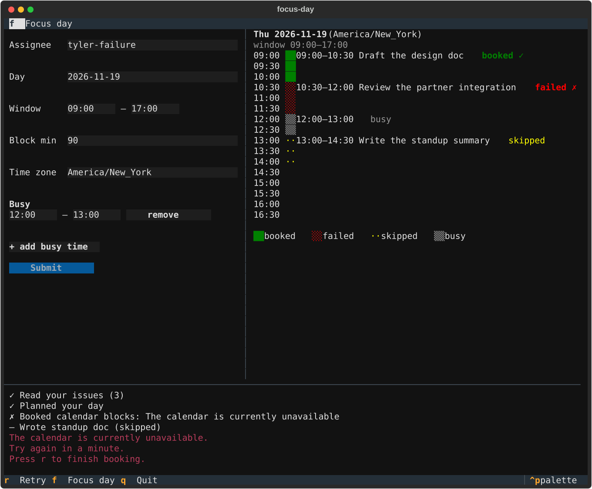
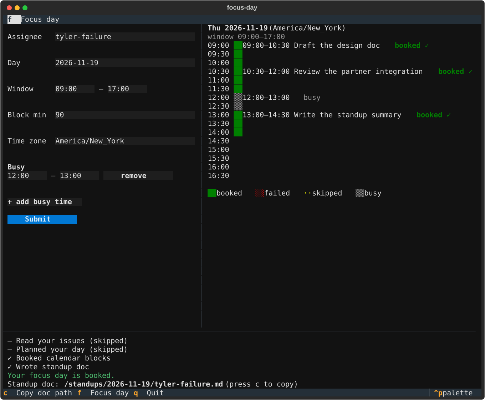

# focus-day TUI: walkthrough and controlled failure

Issue #88 ("Verification"). This file has two parts:

1. **Teammate walkthrough:** to be recorded by a teammate who did not write
   the TUI, using only [product/tui/README.md](../../tui/README.md).
   Not done yet.
2. **Controlled failure:** a focus day through the TUI against a running
   service whose calendar fails partway, then Retry. Done on 2026-11-23.

## 1. Teammate walkthrough

Pending. Record here who ran Focus day (and Progress and Status once those
screens exist) from the README alone, with no coaching, every place they got
stuck, and what was changed because of it.

## 2. Controlled failure: calendar outage, then Retry

Status: PASSED on 2026-11-23, run locally with the in-memory fakes. The
calendar was replaced, by configuration only, with the controlled
implementation from [calendar-failure.md](calendar-failure.md), which goes
down on its second `create`. Through the TUI, the failed run showed the
booked, failed and skipped blocks, saved the run, and Retry finished it
without booking anything twice.

### Setup

| | |
| --- | --- |
| Product and TUI commit | the branch of the TUI's pull request, on top of `a1c014f` |
| Tracker | `ospsd_team4_product.fakes:InMemoryIssueProvider` (three demo issues) |
| Calendar | **`ospsd_team4_product.fakes:calendar_outage_on_second_create`** |
| Storage | `ospsd_team4_product.fakes:InMemoryDocumentStorage` |
| TUI | `focus-day` from `product/tui`, a 110×44 terminal, `FOCUS_DAY_STATE_DIR` set to an empty temporary directory |

```sh
# product/
env -i PATH="$PATH" HOME="$HOME" \
  TRACKER_PROVIDER=ospsd_team4_product.fakes:InMemoryIssueProvider \
  CALENDAR_PROVIDER=ospsd_team4_product.fakes:calendar_outage_on_second_create \
  STORAGE_PROVIDER=ospsd_team4_product.fakes:InMemoryDocumentStorage \
  uv run uvicorn ospsd_team4_product.main:app --port 8000

# product/tui/
uv run focus-day
```

Form: assignee `tyler-failure`, day `2026-11-19`, window `09:00`–`17:00`,
block minutes `90`, time zone `America/New_York`, one busy row
`12:00`–`13:00`. The screenshots were taken with Textual's built-in
`App.save_screenshot()`.

### Run 1: Submit



| Expected (issue #88, ERRORS.md) | Shown |
| --- | --- |
| Step list in user terms | ✓ Read your issues (3), ✓ Planned your day, ✗ Booked calendar blocks: The calendar is currently unavailable, – Wrote standup doc (skipped) |
| Timeline: booked, failed and skipped blocks in distinct styles, with a legend | 09:00–10:30 Draft the design doc **booked ✓**; 10:30–12:00 Review the partner integration **failed ✗**; 13:00–14:30 Write the standup summary **skipped**; 12:00–13:00 busy |
| 502 `provider_error`, retryable: which service, "Try again in a minute." | "The calendar is currently unavailable. Try again in a minute." |
| Retry offered | "Press r to finish booking." and `r Retry` in the footer |
| `plan` and `created` saved | `last-focus-day.json` written with the request, the three-block plan and `created` holding block 1's event |

The service's log for this request (one line, as ERRORS.md documents):

```text
{"event": "focus_day_failed", "status": "partial", "http_status": 502, "step": "create_events", "code": "provider_error", "retryable": true, "may_have_applied": false, "created_events": 1, "cause": "calendar_provider_unavailable"}
INFO:     127.0.0.1:50763 - "POST /v1/focus-day HTTP/1.1" 502 Bad Gateway
```

### Run 2: Retry (`r`)



| Expected | Shown |
| --- | --- |
| Retry sends `replay` built from the saved file | The service skipped the tracker and the planner ("– Read your issues (skipped)", "– Planned your day (skipped)"): it replayed the saved plan |
| Only the missing blocks are booked | ✓ Booked calendar blocks; all three blocks booked ✓ on the timeline |
| The doc is written | ✓ Wrote standup doc; `/standups/2026-11-19/tyler-failure.md`, `c` copies it |
| The saved run is deleted after a successful retry | `last-focus-day.json` gone; only `preferences.json` left |

```text
INFO:     127.0.0.1:50765 - "POST /v1/focus-day HTTP/1.1" 200 OK
```

### Also checked in the same session

- The same form against the service with the normal in-memory calendar:
  200, all three blocks booked around the busy hour
  ([README screenshot](../../tui/docs/focus-day.svg)), and
  `preferences.json` saved with the assignee, window, block minutes and
  time zone.
- The installed `focus-day` console script (built wheel, clean
  environment) in a real terminal: it opens, shows
  `Connected to <url>.`, and quits on `q` with exit code 0. With an
  unreachable URL it opens and shows `Cannot reach the service at <url>.
  Is it running?`. `focus-day --timeout soon` prints the usage and exits
  with code 2. `tests/test_terminal.py` repeats the unreachable case in CI.
