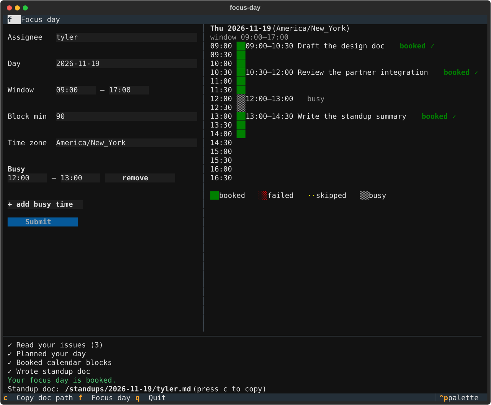

# focus-day TUI

`focus-day` is the terminal interface to the [product service](../README.md).
You fill in a form, it plans your focus blocks around your busy times, books
them in your calendar and writes a standup doc, and it shows the result on a
day timeline.

It talks to the product API over HTTP only. Every product decision (what to
plan, book or retry) stays in the API; the TUI turns your input into the
API's request and shows what comes back.

Screens available now:

| Key | Screen | API call |
| --- | --- | --- |
| `f` | Focus day | `POST /v1/focus-day` |

The Progress and Status screens come with their endpoints (#86, #87).

## Getting started

You need [uv](https://docs.astral.sh/uv/) 0.12.17 or newer. uv downloads
Python 3.14 if you do not have it.

### 1. Install

From the repository root:

```sh
cd product/tui
uv sync
```

### 2. Start the API with the fakes

In a second terminal, start the product service with its in-memory
providers. They need no credentials, and the fake tracker holds three demo
issues:

```sh
cd product
uv sync --locked
export TRACKER_PROVIDER=ospsd_team4_product.fakes:InMemoryIssueProvider
export CALENDAR_PROVIDER=ospsd_team4_product.fakes:InMemoryCalendarService
export STORAGE_PROVIDER=ospsd_team4_product.fakes:InMemoryDocumentStorage
uv run uvicorn ospsd_team4_product.main:app --port 8000
```

Wait for `Application startup complete.`

### 3. Launch `focus-day`

Back in the first terminal (`product/tui`):

```sh
uv run focus-day
```

The bottom panel says `Connected to http://localhost:8000.` If it says
`Cannot reach the service at …`, the API from step 2 is not running or
listens on another port; the app stays open, so start the API and submit.

Launch options:

| Option | Default | Meaning |
| --- | --- | --- |
| `--api-url URL` | `$FOCUS_DAY_API_URL`, else `http://localhost:8000` | Where the product API runs |
| `--timeout SECONDS` | `60` | How long to wait for each request |

A bad option (for example `--timeout soon`) prints the usage and exits with
code 2 before the screen opens.

### 4. Plan a focus day



1. **Assignee**: whose issues to plan, for example `tyler`.
2. **Day**: today by default, as `YYYY-MM-DD`.
3. **Window**: your working hours as `HH:MM` – `HH:MM`, for example
   `09:00` – `17:00`. Leave both empty to use the service's default.
4. **Block min**: how long each focus block is, in minutes. Leave empty to
   use the service's default.
5. **Time zone**: your system time zone by default, as an IANA name such
   as `America/New_York`.
6. **Busy**: press **+ add busy time** for each meeting and enter its start
   and end as `HH:MM` on that day. **remove** deletes a row; an empty row
   is ignored.
7. Press **Submit** (or `Enter` in any field).

The timeline on the right shows your window and busy times while you type.
While the request runs, the bottom panel says
`Planning and booking your focus blocks…`; press `Esc` to stop waiting or
`q` to quit.

When it finishes:

- The **timeline** shows each booked block with its time and issue title.
  The legend explains the marks: `██` booked, `░░` failed, `··` skipped,
  `▒▒` busy.
- Issues that did not fit are listed under the timeline as
  `Not scheduled (no free slot)`.
- The **step list** shows ✓ done, ✗ failed (with why), or – skipped for
  "Read your issues", "Planned your day", "Booked calendar blocks" and
  "Wrote standup doc".
- The **standup doc** path is shown; press `c` to copy it.

A problem with the form (an empty assignee, a time that is not `HH:MM`, an
end before its start, …) is shown next to the field and nothing is sent.
Problems the API finds are shown the same way when they belong to a field.
Every error message says what to do next.

### 5. Finish a run that stopped partway (Retry)

If the calendar or storage fails partway, the timeline shows which blocks
were booked, which one failed and which were skipped, and the panel says
`Press r to finish booking.` Press `r`: the TUI sends the API the plan and
the events it already booked (`replay`), so only the missing blocks are
booked and nothing is booked twice. This also works after you close and
reopen the app. With nothing to retry, `r` says `Nothing to retry.`

To try it, restart the API in step 2 with a calendar that fails on its
second booking:

```sh
export CALENDAR_PROVIDER=ospsd_team4_product.fakes:calendar_outage_on_second_create
uv run uvicorn ospsd_team4_product.main:app --port 8000
```

Submit, then press `r`. The run is recorded in
[docs/evidence/tui-walkthrough.md](../docs/evidence/tui-walkthrough.md).

### Key bindings

| Key | Action | When |
| --- | --- | --- |
| `f` | Go to the Focus day form | always |
| `Enter` | Submit | in a form field |
| `r` | Retry: finish the last run that stopped partway | a run is saved |
| `c` | Copy the standup doc path | after a successful run |
| `Esc` | Stop waiting / leave a text field so single-key shortcuts work | always |
| `q` | Quit | outside a text field |
| `Tab` / `Shift+Tab` | Next / previous field | always |

`f`, `r`, `c` and `q` type into a text field when one is focused; press
`Esc` first. The footer always lists the keys that work right now.

## What it saves

In `~/.focus-day/` (or `$FOCUS_DAY_STATE_DIR`):

| File | Contents | When |
| --- | --- | --- |
| `preferences.json` | assignee, window, block minutes, time zone | after each successful run; used as the form's defaults next time |
| `last-focus-day.json` | the request, `plan` and `created` of a run that stopped partway | after a run fails at booking or the doc; deleted after a successful retry |

Both are conveniences on your machine; deleting them is safe.

## Development

Same checks as CI (`.github/workflows/ci-product.yml`, job `tui`), from
`product/tui`:

```sh
uv sync --locked
uv run ruff check .
uv run ruff format --check .
uv run mypy src tests
uv run pytest
```

The tests drive the app with Textual's `App.run_test()` and fake the API
with `httpx.MockTransport` (injected through `FocusDayApp(transport=…)`),
using response bodies from [DESIGN.md](../docs/DESIGN.md) and
[ERRORS.md](../docs/ERRORS.md). `tests/test_terminal.py` also starts the app
in a pseudo-terminal, which catches startup problems the headless harness
cannot. `tests/test_import_boundary.py` keeps the TUI off the product's
code, databases and provider packages.

| Module | Role |
| --- | --- |
| `cli.py` | `focus-day` launch options |
| `app.py` | The Textual app and the Focus day screen |
| `form.py` | Form input to the API request; form-level checks |
| `client.py` | HTTP calls and response parsing |
| `messages.py` | Steps and errors in user terms |
| `timeline.py` | The day timeline |
| `state.py` | `preferences.json` and `last-focus-day.json` |
